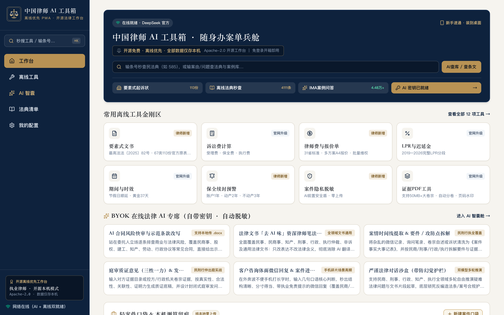
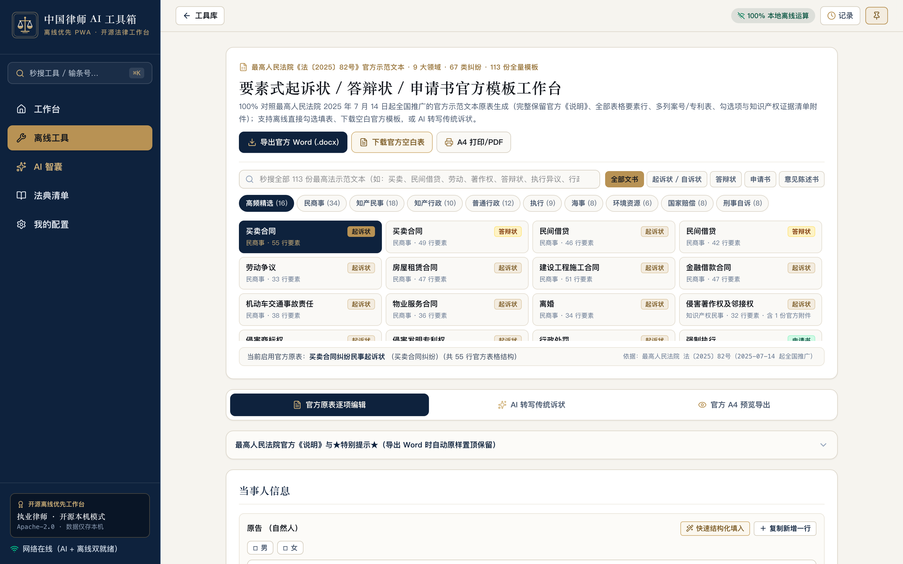
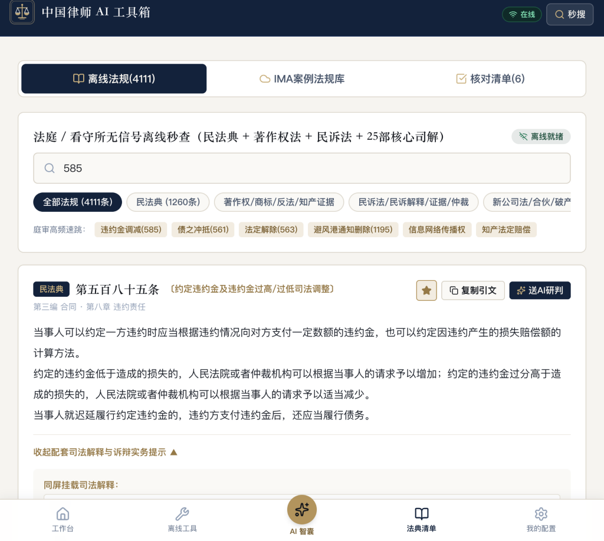
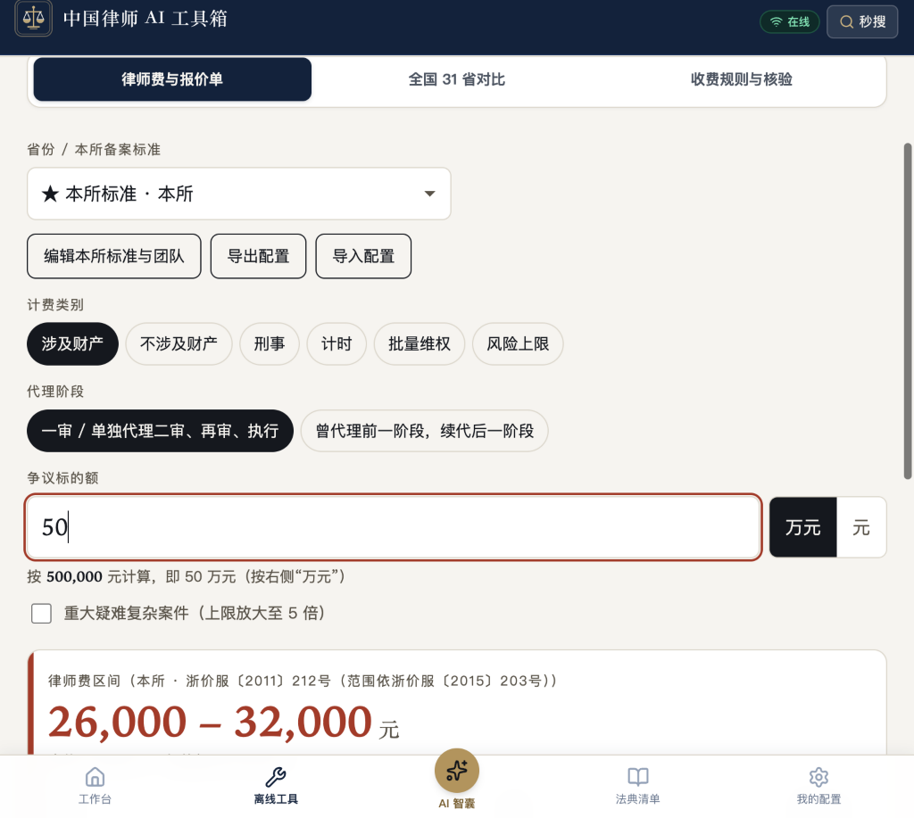

# ⚖️ 中国律师 AI 工具箱（CN Lawyer AI Toolbox）

[](./LICENSE)
[](https://github.com/qwertyzhu/cn-lawyer-ai-toolbox/actions/workflows/ci.yml)
[](#核心功能全景)
[](#30-秒极速运行)

> **一款由中国执业律师实战打磨、本地优先（Offline-First）+ 自带密钥（BYOK）的随身办案单兵工作台。**  
> 涵盖**最高人民法院《法〔2025〕82号》全量 9 大领域 · 67 类纠纷 · 113 份官方要素式起诉状/答辩状/申请书真 Word (`.docx`) 生成**、**4,111 条离线法典与同屏司法解释**、**全国 31 省律师费与多方案 A4 报价单**、**50MB+ 本地保密证据 PDF 分卷与页码水印**、**一键案件隐私脱敏/还原**，以及 **6 大防幻觉法律 AI 专席**。

---

## ✨ 界面预览（100% 脱敏实机截图）

<p align="center">
  
</p>

| 最高法 113 份官方要素式起诉状/答辩状（真 `.docx` 导出） | 4,111 条离线法典秒查（含司法解释与实务提示） |
| :---: | :---: |
|  |  |

| BYOK 6 大法律 AI 专席 + 前置自动脱敏盾 | 全国 31 省律师费测算与 A4 客户报价单 |
| :---: | :---: |
|  |  |

---

## 🧭 为什么做这个开源项目？

执业律师每天在法庭、看守所、律所与客户会见之间奔波，却长期面临四个痛点：
1. **最高法全面推广表格化要素式起诉状**，传统起诉状转写和 Word 表格排版耗费大量非核心时间；
2. **数据保密与 AI 幻觉焦虑**：案件卷宗、委托人信息不能直接裸奔上传陌生云端 SaaS，通用聊天模型又动辄编造法条和案号；
3. **法庭/看守所无信号**：急需核查《民法典》条文、算诉讼费/LPR/债之冲抵、或合并拆分 50MB 证据 PDF 时断网抓瞎；
4. **重复造轮子**：很多律所团队想拥有一套安全可控的内部工具箱，但从零搭建合规计算器、PWA 离线缓存和团队发码管理成本极高。

因此，我们将日常真实办案中打磨成型的这套工作台，**彻底剥离律所内部信息与个人隐私数据后，以 [Apache License 2.0](./LICENSE) 完整开源**：
- **个人律师 / 法务**：默认 `AUTH_MODE=open`，**零登录墙、开箱即用**，甚至可直接纯静态托管在 Vercel / Cloudflare Pages 或本地运行；
- **律师事务所 / 法律团队**：内置可选 `AUTH_MODE=license` 模式，一条命令 `npm run init-keys` 生成本所专属 **ECDSA P-256** 非对称密钥对，即可拥有**实名激活码签发、激活码即账号跨端加密自动同步、防误覆盖确认弹窗与主任端账号实时启停管理台**。

---

## 🚀 核心功能全景

### 一、12 项 100% 本地离线硬核工具（零上传 · 断网可用）

| 分类 | 工具模块 | 核心能力 |
| :--- | :--- | :--- |
| **立案与起草** | **01 要素式起诉状 / 答辩状 / 申请书（最高法 2025 官方全量版）** | 100% 依据最高人民法院《法〔2025〕82号》官方示范文本，完整内置 **9 大领域、67 类纠纷、113 份官方原表**；支持离线交互勾选填表、一键带入个人执业档案、AI 按官方表逐行转写，并支持复用已填主体**一键联出 5 份立案前序配套 Word 文书**（《授权委托书》《送达地址确认书》《财产保全申请书》《律师调查令申请书》《撤诉申请书》） |
| **民商与执行** | **02 诉讼费与全成本计算器** | 依据《诉讼费用交纳办法》，同步测算一审、简易减半、保全费、二审与执行费 |
| | **03 全国 31 省律师费与报价单** | 内置全国 31 省核验标准 + 自定义本所标准；常规/半风险/全风险（司发通〔2021〕87 号红线校验）/计时/知产批量维权；现场点字改价的 A4 多方案报价单 & 合理开支测算单 |
| | **04 LPR 逾期利息与迟延履行金** | 内置 2019–2026 央行完整 1 年/5 年期 LPR 历史表，自动按调息日分段拆算及日万分之 1.75 加倍迟延履行金 |
| | **05 文书金额大写 & 第 561 条债之冲抵** | 标准财务/法院大写、赔偿分项汇总，及《民法典》第 561 条（费用→利息→本金）多期还款自动冲抵表 |
| | **06 法律期间与诉讼时效速算器** | 内置 2025–2026 法定节假日与调休顺延规则（《民法典》第 203 条）、刑案黄金 37 天，支持导出 `.ics` 手机日历 |
| | **07 财产保全续封预警看板** | 银行冻结 1 年 / 动产 2 年 / 不动产与股权 3 年到期日及提前 30 日红线倒计时徽章 + `.ics` 闹钟导出 |
| **劳动与人损** | **08 劳动争议经济补偿金测算** | N / N+1 / 2N / 双倍工资及三倍社平封顶核算（支持按地区自定义社平基数） |
| | **09 工伤与人身损害赔偿测算** | 清晰拆分工伤社保基金支付与单位自付，同步支持道交人身损害城乡统一标准 |
| **隐私与卷宗** | **10 案件材料一键脱敏与还原器** | 100% 本地识别替换姓名、公司全称、身份证号、统一信用代码、手机号、银行卡号与案号；AI 输出后一键反向还原真实主体 |
| | **11 保密证据 PDF 工具箱（50MB+）** | 100% 本地浏览器处理：大卷宗合并、截图转 PDF 压缩、按 **10MB（网上立案）/ 50MB（仲裁大卷）** 一键自动分卷拆分，并加盖高清连续中文页码与举证水印（内置 `Noto Sans SC` 离线字体） |
| | **12 会见 / 庭审 / 咨询结构速记板** | 看守所会见/庭审/面谈离线防丢速记，一键转交 AI 生成结构化纪要 |

### 二、4,111 条离线法典库 + 持续更新的公共云端法规案例库

- **离线秒查（4,111 条）**：内置完整《民法典》（1,260 条）及 35+ 部高频核心法律与配套司法解释（《民事诉讼法》《新公司法》《著作权法》《商标法》《劳动合同法》《民法典合同编通则解释》等），输入数字如 `585` 一秒直达条文原文、同屏挂载司法解释及实务办案提示（`litTips` / `nonLitTips`）。
- **公共云端扩展库（免费直达）**：内置一键直达由本项目作者持续维护更新的腾讯 IMA 共享知识库——  
  👉 **[《法律法规案例库（持续更新 · 4.48 万+ 文献）》（腾讯 IMA 公开库）](https://ima.qq.com/wiki/?shareId=a5d4993fac94797dc3892f0157c5a4011efd105c495d2b0e45ac311dc7dda91b)**  
  （支持个人免费在线语义问答；若律所自建服务端并配置自己的 IMA OpenAPI 凭据，还可开启工作台内联 PDF 正文抽取与 RAG 溯源问答。）

### 三、BYOK 法律 AI 智囊舱（自带密钥 · 隐私可控）

- **6 大全领域法律专席 + 精品文书排版台**：`AI-01 合同风险快审`、`AI-02 法律文书去 AI 味`、`AI-03 案情时间线与要件拆解`、`AI-04 庭审质证与封闭式发问`、`AI-05 客户体面微信回复`、`AI-06 严谨法律对话沙盒`。全部专席均内置**按执业领域分组的场景预设（民事/民商事、知识产权、刑事辩护与控告、行政诉讼与复议、执行与仲裁、非诉函件/常法顾问及其他通用文书）**、**常用指令收藏夹**与**暖象牙纸面法律 Markdown 排版引擎（支持直接渲染 7 列核对表与时间线表）**。
- **轻案件口袋 & 执业落款统一档案**：首页支持按案名建立纯本地**轻案件口袋**，自动归组诉讼费/LPR/诉状测算与保全期限并一键导出《案件初评估简报.docx》；「我的配置」填一次个人执业落款档案即可联动全部文书与报价单。
- **隐私安全闭环**：默认开启「发送前自动本地脱敏 + 收到回复自动本地还原」，支持直接导入本地 `.docx`/`.txt` 与截图（多模态视觉识图），且自带**本机 4–8 位 PIN 码保险箱**（Web Crypto `PBKDF2 + AES-256-GCM` 密文保存 API Key）。
- **多厂商直连 + 模型自动拉取**：原生支持 DeepSeek、阿里云百炼（通义千问）、硅基流动、月之暗面 Kimi、智谱 GLM、火山方舟豆包、OpenAI、Anthropic Claude 及本地 Ollama / OpenAI 兼容接口；填入 Base URL 与 API Key 后支持**一键自动拉取可用模型列表**并智能匹配极速/推理/识图槽位。
- **激活码跨端加密自动同步（`AUTH_MODE=license` 模式）**：律师在任意设备配置一次 API Key、模型与常用办案偏好，系统自动按激活码以 `AES-256-GCM` 密文隔离同步（另可选零知识独立同步口令）；换手机或新浏览器打开激活链接 1 秒自动恢复配置，无需重复填写。

---

## ⚡ 30 秒极速运行

### 方式一：本地一键运行（推荐 · 个人律师 0 配置开箱）

需要 **Node.js 20+**（推荐 Node.js 22）：

```bash
git clone https://github.com/qwertyzhu/cn-lawyer-ai-toolbox.git
cd cn-lawyer-ai-toolbox
npm ci
npm run build
npm start
```

打开浏览器访问 **http://127.0.0.1:3680** 即可立即使用全部功能！（开发调试可运行 `npm run dev`。）

### 方式二：Docker 一键部署

```bash
docker build -t cn-lawyer-ai-toolbox .
docker run -d --name cn-lawyer-box \
  -p 3680:3680 \
  -e AUTH_MODE=open \
  -e ENABLE_AI_RELAY=false \
  cn-lawyer-ai-toolbox
```

### 方式三：纯静态部署（Vercel / Cloudflare Pages / Netlify / Nginx）

本项目在默认 `AUTH_MODE=open` 下核心工具与 4,111 条离线法典均为纯前端静态产物：
- **Build Command**: `npm run build`
- **Output Directory**: `dist`
- （注：纯静态托管时，浏览器直连支持 CORS 的大模型 API 如 DeepSeek / 阿里云百炼 / 硅基流动即可，无需后端中转。）

---

## 🏛️ 律所团队私有化部署模式（可选 `AUTH_MODE=license`）

如果您希望为本所内部律师部署带有**实名激活码门禁、已绑定设备防误覆盖保护、及主任端实时账号启停管理台**的私有化工作台，只需 4 步：

1. **生成本所专属 ECDSA P-256 非对称密钥对**（私钥仅存在本地 `ops/.keys/` 且默认 gitignore，公钥自动写入前后端）：
   ```bash
   npm run init-keys -- --firm="某某律师事务所"
   ```
2. **配置 `.env`**（参考 [`.env.example`](./.env.example)）：
   ```dotenv
   VITE_APP_NAME=某某律师AI工具箱
   VITE_FIRM_NAME=某某律师事务所
   VITE_AUTH_MODE=license
   AUTH_MODE=license
   ENABLE_AI_RELAY=true
   ```
3. **重新编译并启动服务端**：
   ```bash
   npm run build && npm start
   ```
4. **为本所律师签发专属实名激活码**（支持命令行批量发码，或生成本地双击即开的离线发码器 HTML）：
   ```bash
   npm run keygen -- --names "张示范:主任,李示例:合伙人,王示例:专职律师" --origin "https://box.yourfirm.com"
   # 或生成主任电脑本地双击即开的离线发码台（机密文件，严禁上传 Git）：
   npm run build:keygen
   ```

> 💡 **安全架构亮点**：服务端与前端代码中仅包含**公钥**，即便服务器被完整打包也无法伪造激活码；若已绑定的律师在手机上误点同事的 `?activate=` 链接，系统会弹出**防误覆盖确认弹窗**自动拦截，防止本机身份被意外切换。详见 [SECURITY.md](./SECURITY.md)。

---

## 🧪 测试与开源防泄密守卫

```bash
# 运行核心引擎单元测试（财务大写、561冲抵、风险代理上限、本地脱敏、AES-GCM保险箱、ECDSA P-256 验签、OOXML .docx 双向校验等）
npm test

# 运行开源完整性与隐私防泄密红线守卫（CI 自动执行）
npm run test:guard
```

---

## 🤝 参与贡献

特别欢迎各位法律同行与开发者提交 PR（如更新年度 LPR / 节假日 / 各省社平工资基数、新增最高法要素式诉状案由模板、完善法典实务提示等），请先阅读 [CONTRIBUTING.md](./CONTRIBUTING.md)。

---

## 📜 开源协议、署名与免责声明

- **开源协议**：本项目遵循 **[Apache License 2.0](./LICENSE)** 开源，商用与二次开发友好，再分发或基于本项目搭建衍生服务时请依据 Apache-2.0 第 4(d) 条保留 [NOTICE](./NOTICE) 中的原始版权署名，并遵守第 6 条商标与非背书边界。
- **法律免责声明**：使用前请务必阅读 **[DISCLAIMER.md](./DISCLAIMER.md)**。本工具仅作为法律专业人员的效率辅助工具，不构成正式法律意见；所有 AI 输出、计算结果与文书草稿均须由执业律师独立复核现行有效法条与案件证据后方可使用。
- **原作者**：由 **lawyer朱思浩（[@qwertyzhu](https://github.com/qwertyzhu)）** 发起并开源维护。如果这个工具帮您省下了宝贵的办案时间，欢迎点亮右上角 ⭐ **Star**，并收藏分享持续更新的 [《法律法规案例库》](https://ima.qq.com/wiki/?shareId=a5d4993fac94797dc3892f0157c5a4011efd105c495d2b0e45ac311dc7dda91b)！
